# Gymlytics End-User Manual

**Applies to:** Gymlytics 0.1.0 · **Last updated:** 2026-11-23 · **Audience:** academy staff, coaches, members and guardians (no technical knowledge needed)

This manual shows you how to use Gymlytics in everyday situations: signing in, checking members in, booking classes, signing waivers, taking payments and finding your child's progress. Every screen name and button below matches the current application.

- New here? Start with [1. Onboarding tutorials](#1-onboarding-tutorials).
- Looking for one task? Use [3. Everyday recipes](#3-everyday-recipes).
- Something not working? Go to the [FAQ](faq.md) or the [troubleshooting guide](troubleshooting.md).

> Screenshots in this manual are stored in [`../screenshots/`](../screenshots/) and are illustrative; the live screen may show newer labels or different demo names.

---

## Before you start

### What you need

| Surface | What you need | Where to open it |
| --- | --- | --- |
| Staff console | Academy **slug**, your **email** and **password** | `http://localhost:5173/login` in development, or the web address your academy gave you |
| Front-desk tablet | Academy slug, a **device ID** and the **device key** from your administrator | `/kiosk` on the tablet |
| Waiver tablet | The tablet must already be paired | `/waiver` |
| Mobile app | Your member email and password | Gymlytics app (Expo Go in development) |
| Family portal | A guardian account linked to a child | `/family` |
| Public widgets | No login; just the link your academy published | The academy website |

The **academy slug** is your academy's short web address name, for example `gymlytics-demo`. It keeps each academy's data separate. If you do not know yours, ask your front desk or owner.

### Demo accounts (practice only)

The seeded demo academy uses the password `Password123!` for every account below.

| Role | Email | Kiosk PIN | Academy slug |
| --- | --- | --- | --- |
| Owner | `owner@gymlytics.test` | `1234` | `gymlytics-demo` |
| Coach | `coach@gymlytics.test` | `1235` | `gymlytics-demo` |
| Front desk | `frontdesk@gymlytics.test` | `1236` | `gymlytics-demo` |
| Guardian | `parent@gymlytics.test` | `1240` | `gymlytics-demo` |
| Student | `daniel@student.test` | `1200` | `gymlytics-demo` |
| Branch admin | `branch-admin@gymlytics.test` | `1300` | `gymlytics-demo-pj` |

> Demo credentials are for the seeded practice academy only. Never reuse this password on a real academy, and change the demo password before using the system for real members.

### What each role can do

| Your role | Where you work | What you can do |
| --- | --- | --- |
| Owner / admin | Staff console | Everything, including plans, imports, website widgets, branches and setup |
| Staff | Staff console | Members, waivers, billing, point of sale, reports |
| Coach | Staff console | Roster, schedule, attendance, programs, promotions; no billing or settings |
| Guardian | Family portal, mobile Family tab | See linked children's schedules, progress and permissions |
| Student | Mobile app | See schedule, book classes, view progression and curriculum videos |
| Drop-in visitor | Waiver tablet | Sign a visitor waiver before training |

If a menu item is missing, it is hidden for your role, not broken. Students and guardians who open the staff console are sent to the kiosk instead.

---

## 1. Onboarding tutorials

### 1.1 Sign in to the staff console (first time)

1. Open the web address for Gymlytics. You will land on the **Sign in** page.
2. Enter your **Email** (for example `owner@gymlytics.test`).
3. Enter your **Password**.
4. Enter your **Academy slug** (for example `gymlytics-demo`).
5. Select **Sign in**.
6. You will arrive at the **Dashboard**. If you were trying to open a specific page, you are taken there after signing in.

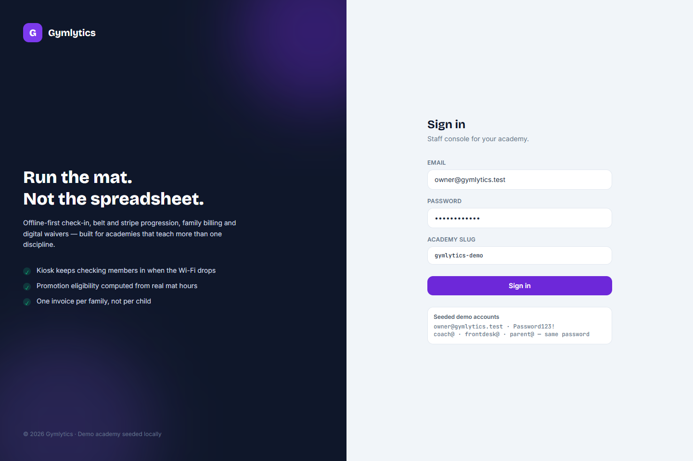

**Tip:** If the page says "Failed to fetch", that is a connection problem, not a wrong password. See [I cannot sign in](troubleshooting.md#i-cannot-sign-in).

### 1.2 Owner setup: the six guided steps

Owners and admins can open **Workspace → Setup** in the sidebar. The page shows a progress bar and six steps. Work through them in order; each step has an **Open** button that takes you to the right page, and a **Mark done** button when the work is finished.

| # | Step | What to do on that page |
| --- | --- | --- |
| 1 | Academy profile | Confirm your academy name, currency, timezone and branding on the Dashboard. |
| 2 | Locations | Add branches under **Network** and decide who administers them. |
| 3 | Programs & belts | Open **Programs** and add your disciplines, belt ranks, stripes and technique requirements. |
| 4 | Import members | Open **Imports**, download the template for the type you need, then upload your roster. |
| 5 | Billing | Open **Billing** and create your membership plans, products and payment provider. |
| 6 | Invite your team | Open **Members** and add coaches and front-desk staff with their kiosk PINs. |

Completing a step is safe to repeat: it is recorded only once. Setup is finished when the page says "Setup complete — welcome to Gymlytics."

### 1.3 Pair the front-desk tablet (one time)

The kiosk needs a device key from your administrator before it can check people in.

1. On the tablet, open `/kiosk`. The **Pair this tablet** screen appears.
2. Enter the **Academy slug**.
3. Enter a **Device id** that identifies this tablet, for example `kiosk-lobby-01`. Give every tablet a different ID.
4. Enter the **Device key** provided by your administrator (in the demo: `dev-kiosk-key`).
5. Select **Pair device**. You will see "Warming up the local mat…" while the tablet loads its local copy of the roster.
6. Once ready, the front-desk check-in screen appears. You do not need to pair again after a restart.

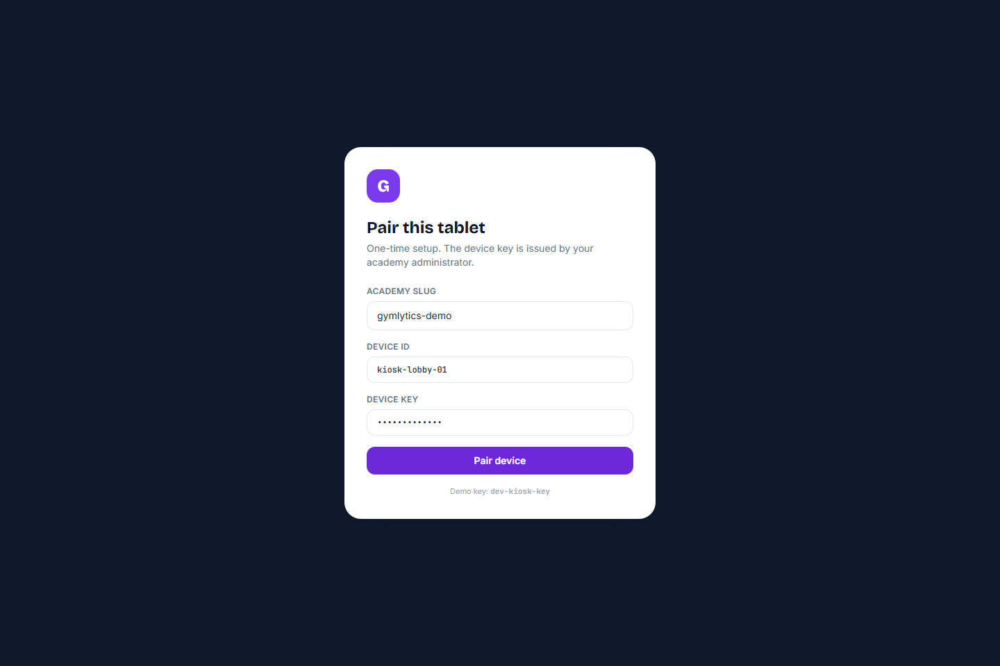

**Unpair** at the top right is only for moving the tablet to another academy or retiring it. You will need the device key to pair again.

### 1.4 Set up the mobile app (members)

1. Install the Gymlytics app provided by your academy (in development, open it through Expo Go).
2. On the **Sign in** screen, enter your member **Email** and **Password**, then select **Sign in**.
3. You land on **Home**, titled "Your training". The bottom bar shows: **Home**, **Schedule**, **My classes**, **Family**, **Library** and **Profile**.
4. Open **Profile** to check that the academy name, slug, currency and timezone are correct.

Members sign in with email and password only; there is no academy slug field in the app.

### 1.5 Guardian first visit

1. Ask the front desk to link your guardian account to your child and confirm which permissions you have: book classes, sign waivers and view progress are granted per child.
2. Sign in on the web and open `/family`, or open the **Family** tab in the mobile app.
3. Select your child's name chip at the top. Their upcoming classes and rank journey appear.
4. If the page says "No linked children", the link has not been created yet — ask the front desk, not the child's coach.

---

## 2. Feature walkthroughs

### 2.1 Find your way around the staff console

The sidebar is grouped into six sections. The dashboard gives you today's numbers and anything that needs attention.

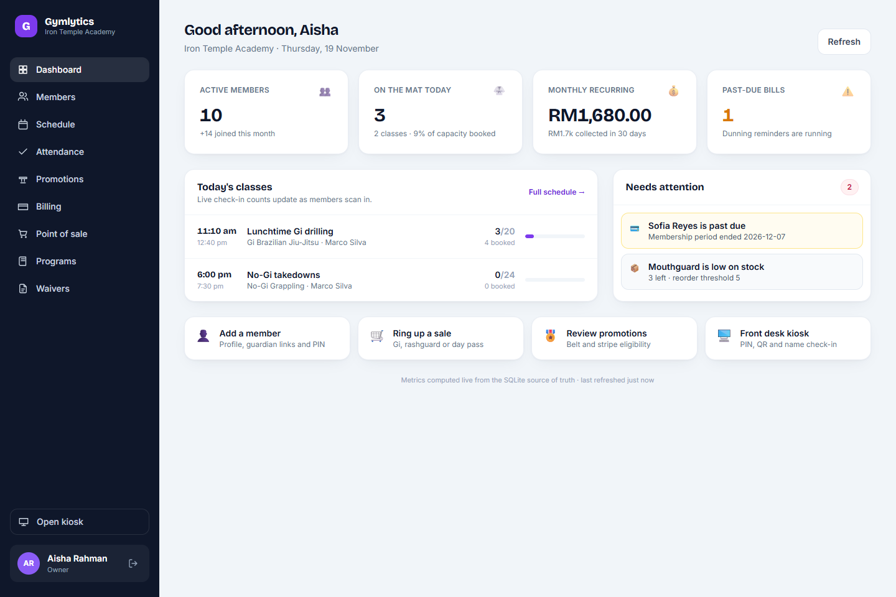

| Section | Pages |
| --- | --- |
| Overview | Dashboard |
| People | Members, Attendance, Waivers |
| Operations | Schedule, Programs, Curriculum, Promotions |
| Sales & billing | Billing, Point of sale, Passes |
| Insights | Analytics, Reports |
| Workspace | Setup, Imports, Embeds, Network, Plan |

On a narrow screen, use the menu button at the top left to open the sidebar, and the X to close it. **Open kiosk** at the bottom of the sidebar opens the front-desk tablet in a new tab.

### 2.2 Members

**Find someone:** open **People → Members**. Use the search field and the status and role filters (Active, Frozen, Pending waiver, and so on). Use **Previous** / **Next** to page through results. Select a row to open the member dossier.

**Add someone:** select **Add member** and fill in first name, last name, email, phone, date of birth, role and (if needed) a 4–8 digit **Kiosk PIN**. Add emergency contact details and notes. The PIN is stored as a hash — if a member forgets it, staff must set a new one; nobody can read the old one back.

**In the dossier** you can see guardians, dependents, memberships, waivers, promotions and attendance count, plus the member's QR token for their card. Every change is recorded with who made it and when.

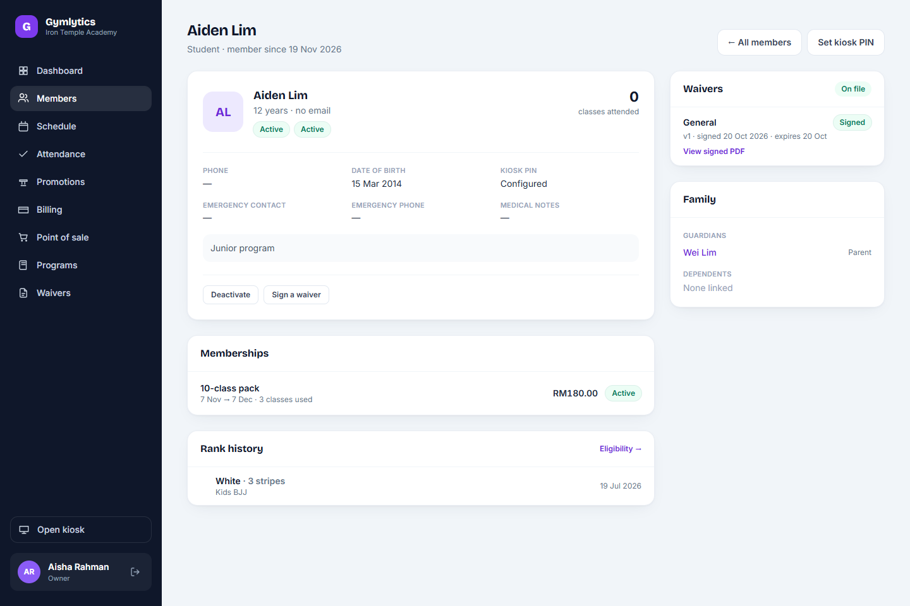

### 2.3 Schedule and attendance

**Create a class:** open **Operations → Schedule**, choose the week and select **Add class** (or click an empty day slot). Enter the program, title, start and end times, capacity and location. A class needs a program and a time before it can be booked.

**See who is coming:** select a class in the week view. The side panel shows **Roster** (booked members and checked-in count) and **Curriculum** (techniques planned for the class). Coaches can log techniques taught and write a class recap here; students see the recap in the app.

**Check someone out:** open **People → Attendance** and filter by date, class or member. The page shows check-ins, unique members and "Still on the mat". A member who forgot to scan out is counted using the class length, so mat hours stay sensible.

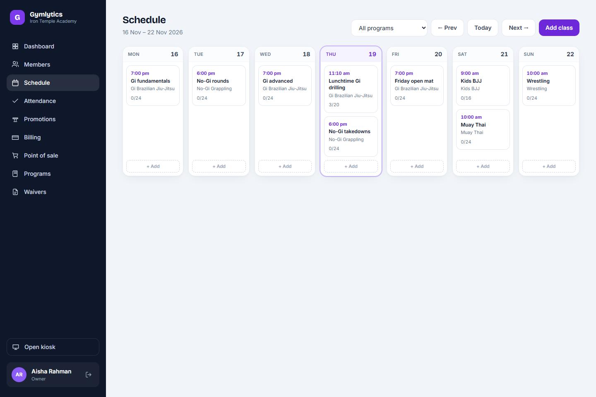 · 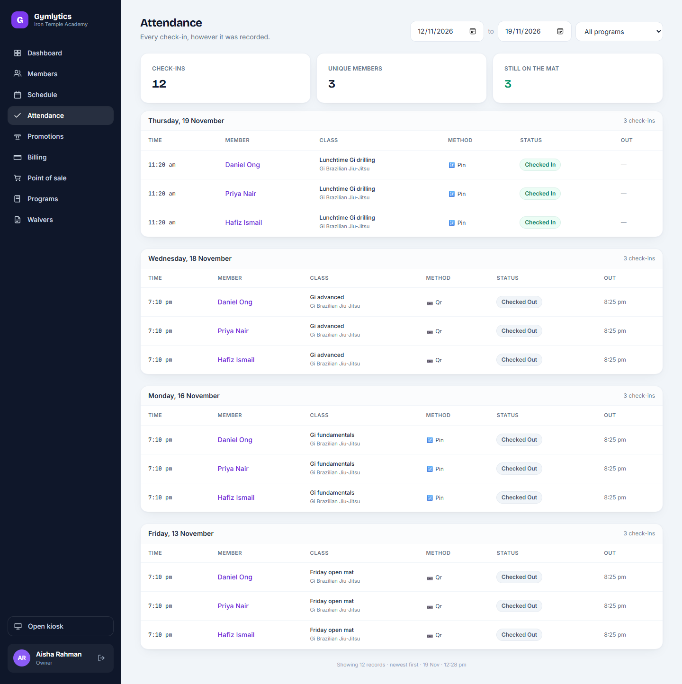

### 2.4 Promotions and progression

Open **Operations → Promotions**. The page shows **Ready for a stripe**, **Ready for a belt** and **Tracked members**, with each member's time in rank, classes, mat hours and curriculum completion.

1. Find the member and confirm the eligibility status.
2. Select **Promote**, choose the belt and number of stripes, then confirm.
3. The promotion is written to an immutable history record with the class and mat-hour counts at that moment.

Students see the same calculation in the app and guardians see it in the **Family portal** under "Eligibility". A label such as "Ready for review" means the requirements are met and a coach still needs to approve it.

### 2.5 Waivers

**Staff register:** open **People → Waivers** to see how many waivers are signed, expiring in 30 days or expired. Filter the **Signed register** by status and select **PDF** on a row to open the exact document the signer agreed to.

**Publish a template:** in the **Templates** section, enter the type (General, Participation, Photo release, Medical or Drop-in), version, title and body. Select **Publish**. Each version has its own document hash, so an old signature always resolves to the wording that was signed.

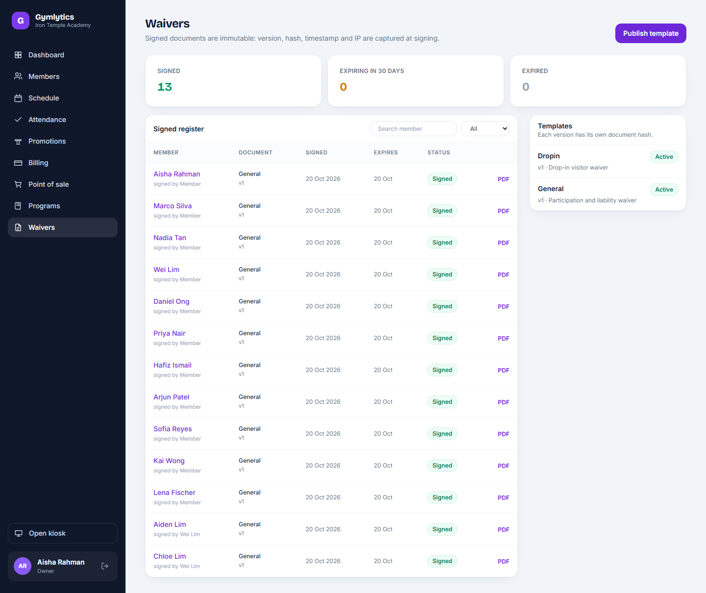

### 2.6 Sign a waiver on the tablet

Use this when a member or visitor needs a current waiver before training.

1. On the paired tablet, open `/waiver`. If the tablet is not paired, select **Go to pairing** and follow [1.3](#13-pair-the-front-desk-tablet-one-time).
2. Read **The agreement**. The template selector shows the type and version, for example `general · v1`.
3. Under **Who is signing?**, select the member from the dropdown. If you came from the kiosk's drop-in screen, the member ID is already filled in.
4. Enter the signer's **Full legal name** and **Date of birth**. If the signer is under 18, a **Parent / guardian name** field appears and must be filled in.
5. In the **Signature** box, sign with a finger, stylus or mouse. Use **Clear** to start the signature again.
6. Tick the agreement checkbox and select **Sign and submit**.
7. When you see "Waiver signed", select **Download PDF** for a timestamped copy or **Sign another** for the next person.

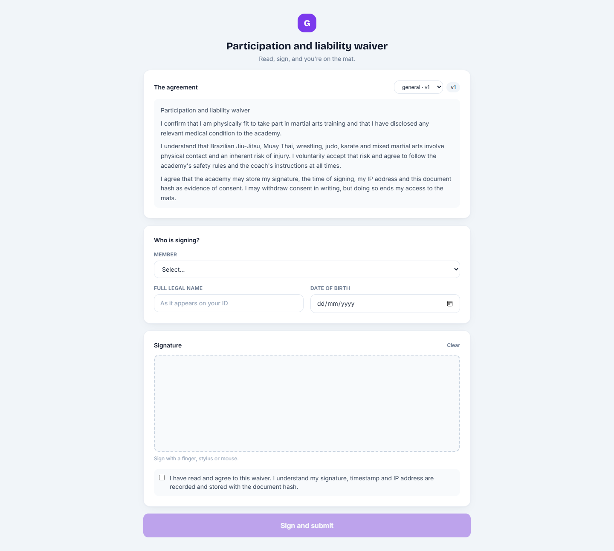

### 2.7 Billing and point of sale

**Plans and memberships — staff and owners:** open **Sales & billing → Billing**. You can see recurring revenue, active memberships and past-due bills. Use the status filter (Active, Past due, Frozen, Cancelled) and the membership table to find someone. **Freeze** asks for the number of days and a reason; **Resume** appears on frozen memberships. Select **Create plan** to add a plan with its type (Unlimited, Weekly limit, Class pack, Drop-in pack or Family), interval, price and freeze allowance.

A failed renewal is retried automatically on days 1, 3, 5, 7 and 12. Once the account is current again, the membership returns to active. If your academy uses an external payment portal for Billplz or iPay88 refunds, handle those there, not in Gymlytics.

**Point of sale:** open **Sales & billing → Point of sale**. Tap products to add them to **Current sale**, select or search for a customer (or leave it as a walk-in), choose a discount and a payment method (Cash / manual, Stripe or Billplz), then select **Checkout**. The last receipt appears below the sale. A day pass can only be sold to someone with a signed waiver.

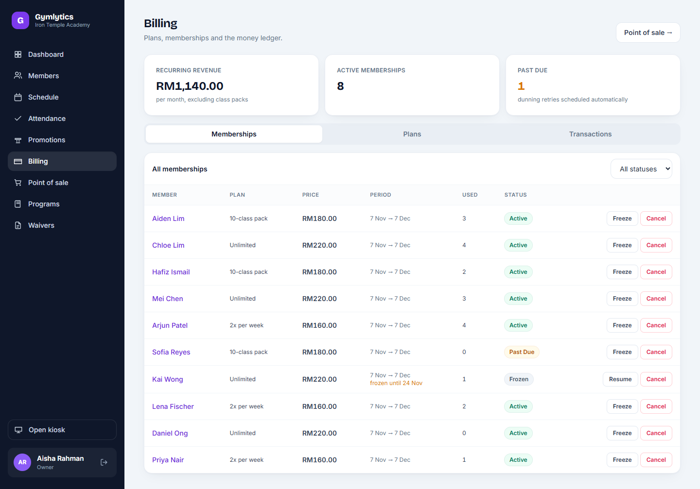 · 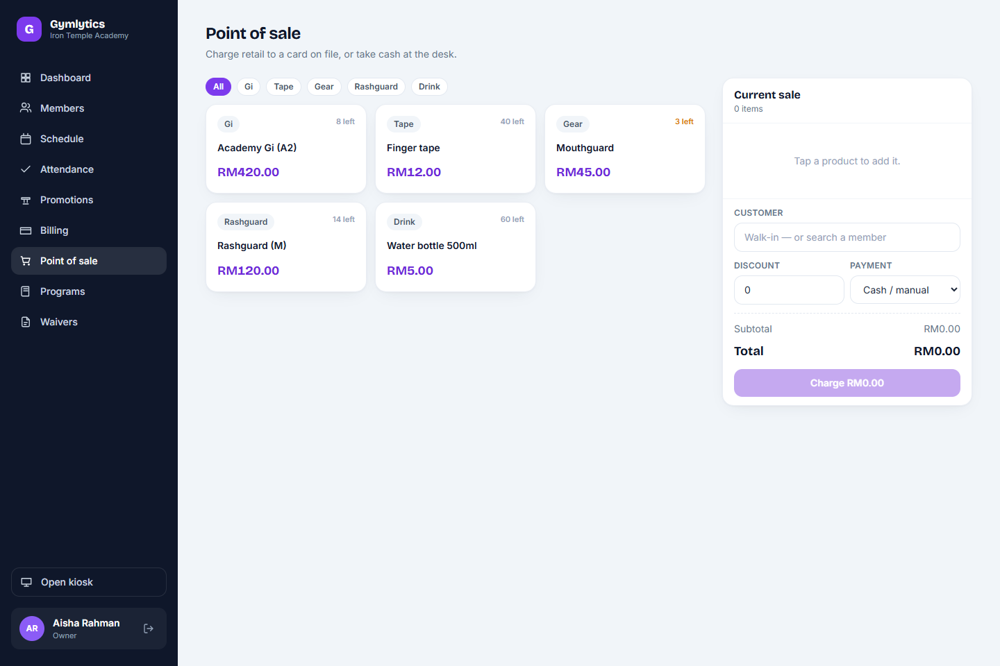

### 2.8 Analytics and reports

**Analytics:** open **Insights → Analytics**. Choose one of the views from the page navigation: Overview, Progression, Attendance, Retention, Financial, Leads or a member drilldown. Use the range picker to change the period. Financial analytics is only available to owner, admin and staff roles. Members see their own progression and class recaps in the app rather than in the staff analytics views.

**Reports:** open **Insights → Reports** and pick one of the eleven definitions, for example belt eligibility, daily roster, instructor payroll, MIA alerts, trial follow-up, failed payments, revenue and tax, pro-shop stock, waiver audit or incidents. Set the date or month filter and export the result as CSV for spreadsheets.

### 2.9 Workspace tools (owners and admins)

| Page | Use it for |
| --- | --- |
| Setup | The six-step launch checklist described in [1.2](#12-owner-setup-the-six-guided-steps). |
| Imports | Download a CSV template for members, belt ranks or billing mandates, then upload it. Each bad row is reported instead of silently skipped. |
| Embeds | Create a **Class schedule**, **Trial booking form** or **Waiver link** widget, copy the embed code and paste it into your website. |
| Network | Add branch academies and see a combined view. A branch admin only sees their own branch. |
| Plan | Review your subscription tier. Widgets, imports and passes need a Growth tier or above; a gated page links here to upgrade. |

### 2.10 Front-desk check-in (kiosk)

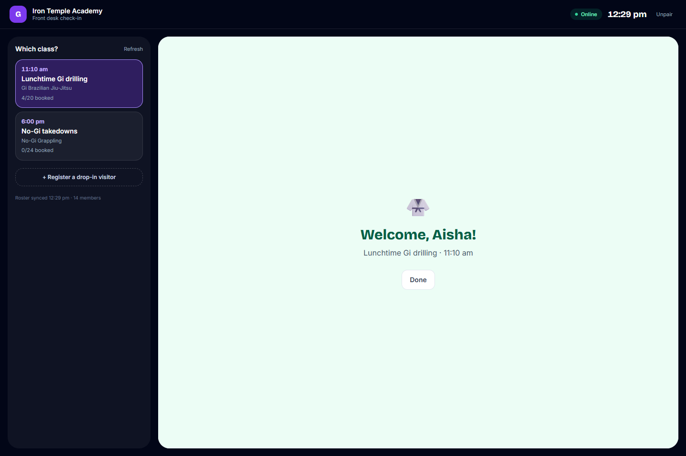

1. On the paired tablet, select the class under **Which class?** on the left. The header shows "Front desk check-in", the connection state and the number of **queued** check-ins.
2. Choose the check-in method on the right: **PIN**, **Name** or **QR**.
   - **PIN:** enter the member's 4–8 digit PIN on the keypad. Check-in starts automatically at four digits.
   - **Name:** type at least two letters and pick the person from the results.
   - **QR:** scan the member card, or type its code (for example `gym_…`) and press Enter.
3. A green message confirms "Welcome, [name]!" with the class and time. Amber lines warn about a past-due membership or a waiver expiring soon.
4. If a waiver is missing, a **Waiver needed** message appears with an **Open waiver** button. Send that person to the waiver tablet, then try again.
5. Use **Sync now** at the bottom to flush queued check-ins immediately. The kiosk also syncs by itself when the connection returns.

**When the Wi-Fi drops:** the badge changes to "Offline — queueing". You can still check people in — the tablet stores each check-in locally and shows it as queued. Nothing is lost on reload or a power cut, and a repeated scan never creates a second attendance record. The roster and class list come from the last successful sync; use **Refresh** when online to update them.

**Register a visitor:** select **+ Register a drop-in visitor**, enter first name, last name and phone (email is optional), then **Register & open waiver**. The visitor profile is created and the waiver screen opens. The visitor cannot train until the waiver is signed.

### 2.11 Member mobile app

| Tab | What you do there |
| --- | --- |
| Home ("Your training") | Your dashboard and quick links |
| Schedule ("Book a class") | Upcoming classes grouped by day, with spots left; select **Book** to reserve, or join the waitlist when full |
| My classes | Upcoming and past bookings; select **Cancel booking** to free your spot ("Keep it" leaves it unchanged) |
| Family | Dependents you can act for, with their schedule and progression |
| Library | Belt-filtered curriculum videos and recaps for classes you attended |
| Profile | Your name, status, role, academy details and linked dependents; **Sign out** is here |

Open a class from the schedule to see its details. If a booking is refused, the app explains why (for example a frozen membership, past-due bill or weekly class limit). The app does not store your card details. There is no offline booking queue on mobile in this version: if the network fails, retry when you are back online.

### 2.12 Family portal (web)

Open `/family` after signing in as a guardian.

1. Your children appear as chips at the top. Select one to switch the whole page to that child.
2. **"[Name]'s upcoming classes"** lists each booking with its date, time and status (for example `booked`). Select a class in the app if you need to book more; the portal is primarily for viewing.
3. **"[Name]'s rank journey"** lists past promotions with the date and stripe count.
4. **Eligibility** shows each program and rank with either "Ready for review" or the missing requirements, such as minimum classes or mat hours.

Only children linked to your account appear, and only with the permissions the front desk granted. If a permission is missing, the action is not available.

### 2.13 Public widgets and cross-training passes

**Widgets** are for prospective members and need no login. The schedule widget lists classes with spots remaining; the trial form collects first name, last name, email and phone and replies "Thanks — we'll be in touch"; the waiver link opens the waiver tablet page. Widgets stop working when an owner disables them in **Workspace → Embeds** or when the subscription no longer includes them.

**Passes** let a verified partner academy's visitor train. Staff add the affiliation in **Sales & billing → Passes**, verify it, then issue a pass. The visitor opens the public link, signs the linked waiver, and staff check them in from the pass page. A visitor without a signed, unexpired waiver cannot be checked in.

---

## 3. Everyday recipes

| I need to… | Do this |
| --- | --- |
| Start the day | Open the Dashboard, check **Today's classes** and **Needs attention**, then open the kiosk. |
| Check in a regular | Kiosk → choose class → PIN, Name or QR → confirm the welcome message. |
| Sign up a first-timer | Kiosk → **Register a drop-in visitor** → waiver tablet → sign → check in. |
| Book my own class | Mobile → Schedule → choose a class → **Book**. |
| See if my child can grade | Family portal → select child → **Eligibility**. |
| Record a promotion | Staff console → Promotions → **Promote** → belt and stripes → confirm. |
| Take payment for a drink | Staff console → Point of sale → tap product → customer → **Checkout**. |
| Pause a membership | Staff console → Billing → **Freeze** → days and reason. A frozen membership with an end date reopens automatically; **Resume** brings it back early. |
| Run the payroll list | Staff console → Reports → Instructor payroll → set dates → CSV export. |
| Publish next month's schedule on the website | Staff console → Embeds → copy the widget embed code → paste into the site. |

---

## 4. Good to know

### Plain-language glossary

| Term | Meaning |
| --- | --- |
| Academy slug | Your academy's short name used to sign in and keep data separate. |
| Booking / waitlist | Your reservation for a class. If the class is full, you are placed on the waitlist instead. |
| Check-in | Confirming that someone arrived for a class. Checking out records when they left. |
| Mat hours | Time spent training, calculated from check-in/check-out or the class length. |
| Waiver | The signed agreement that must be current before someone can train. |
| Membership status | Active, past due, frozen, pending payment or cancelled. |
| Eligibility | Whether a member has met the belt or stripe requirements; a coach still approves the promotion. |
| Queued | A check-in stored on the tablet, waiting to be sent to the academy when the network returns. |
| Widget | A small public block (schedule, trial form or waiver link) you can place on a website. |
| Pass | A QR-style invitation that lets a verified partner's visitor train. |

### Privacy and security

- Your password and kiosk PIN are stored as hashes. Nobody can read them back; staff must reset a forgotten PIN.
- Card numbers and CVVs are never stored in Gymlytics. Payment providers handle them.
- A signed waiver keeps the wording version, signature, timestamp, signer IP and guardian name where applicable.
- Never share your password or the kiosk device key in a group chat, and never type a member's card details into Gymlytics.

### Where to get help

1. Check the [FAQ](faq.md) for a direct answer.
2. Check the [troubleshooting guide](troubleshooting.md) for the message you see on screen.
3. Ask your front desk or owner. For account, PIN, membership or device-key changes, an owner or admin must make the change for you.

For the technical background, see the [documentation index](README.md), the [PRD](prd.md) and the [deployment runbook](deployment-runbook.md).
