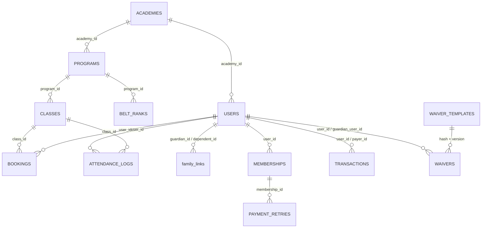

# Gymlytics — Software Architecture Document (SAD)

| Field | Value |
| --- | --- |
| Document version | 1.0 |
| Status | Baseline for 0.1.0 |
| Last updated | 2026-11-23 |
| Owner | Technical lead (name TBD) |
| Related documents | [C4 index](README.md) · [ADRs](adr/README.md) · [SRS](srs.md) · [Deployment & Runbook](deployment-runbook.md) |

---

## 1. Architecture overview

Gymlytics is a TypeScript pnpm/Turborepo monorepo with three apps and four internal packages. The API is the canonical writer; the kiosk is a local-first client that can write before it can sync. Four client surfaces share validation and domain rules through `@gymlytics/shared`, so a rule change is a single edit.

Existing C4 views (authoritative, kept up to date separately):

| View | Document |
| --- | --- |
| L1 context — actors and external systems | [c4-context.md](architecture/c4-context.md) |
| L2 containers — apps, services, databases | [c4-container.md](architecture/c4-container.md) |
| L3 components — kiosk sync internals | [c4-component-kiosk-sync.md](architecture/c4-component-kiosk-sync.md) |

### 1.1 Design principles

1. **One codebase, three clients, one contract layer** — Vue web, Expo mobile and Fastify API consume the same Zod schemas and pure functions (ADR-0001, ADR-0005).
2. **Two databases, one schema shape** — server Drizzle/SQLite and kiosk OPFS SQLite use the same portable DDL subset (ADR-0002).
3. **Local identity, atomic outbox** — client-generated UUIDv7 and mutation id; entity + outbox commit together (ADR-0003).
4. **Idempotency at every boundary** — `applied_mutations`, `webhook_events`, `transactions.idempotency_key`, POS keys (ADR-0003, ADR-0004).
5. **Capability-based integrations** — payment and notification mechanics are injected; provider choice is data (ADR-0004).
6. **Tenant scope by construction** — `academy_id` on every domain table and in every query (ADR-0006).

## 2. Technology stack

| Layer | Technology | Version / source |
| --- | --- | --- |
| Monorepo | pnpm workspaces + Turborepo | pnpm 9.12.0, Turbo ^2.1.3, Node ≥20.11 (containers use Node 22) |
| Language | TypeScript strict | ^5.6.3, ES2022, bundler resolution, `@gymlytics/*` path aliases |
| API | Fastify + Zod | Fastify ^5.1.0, `@fastify/cors` ^10.0.1, zod ^3.23.8 |
| API build / dev | tsup, tsx, vitest | tsup ^8.3.5, tsx ^4.19.1, vitest ^2.1.2 |
| Web | Vue 3, vue-router, Vite, Tailwind | Vue ^3.5.12, Vite ^5.4.8, Tailwind ^3.4.13 |
| Kiosk local DB | sqlite-wasm + OPFS | `@sqlite.org/sqlite-wasm` ^3.46.0-build2 |
| Mobile | Expo + React Native | Expo ~52, RN 0.76.5, expo-router ~4, expo-secure-store ~14 |
| Database | SQLite via Drizzle + better-sqlite3 | drizzle-orm ^0.44.5, better-sqlite3 11.10.0, drizzle-kit ^0.31.4 |
| Payments | Custom adapters | Stripe, Billplz, iPay88; `pdf-lib` ^1.17.1 for waivers |
| Testing | Vitest + `app.inject()` | API integration, pure-domain unit, provider unit, smoke script |
| CI/CD | GitHub Actions + GHCR + Docker Compose | `.github/workflows/{ci,cd}.yml`, `Dockerfile.api`, `Dockerfile.web` |
| Edge | nginx | nginx 1.27-alpine, reverse proxy for `/v1` and `/health` |

## 3. Workspace map

```
apps/
  api/        Fastify server, modules, jobs, libs, smoke script
  web/        Vue 3 admin + kiosk + waiver + public widgets, local sync engine
  mobile/     Expo student/guardian app
packages/
  db/         Drizzle schema, migrations, seed, client, UUIDv7 helpers
  shared/     Zod DTOs, constants, pure domain functions (no platform APIs)
  sync/       HLC, outbox, conflict resolution, push/pull engine, adapters
  payments/   PaymentProvider interface, router, crypto, webhooks, dunning
docs/
  architecture/  C4 views      adr/  decisions
  *.md            charter, PRD, SRS, SAD, test plan, runbook, release notes
```

Dependency direction: `apps → packages`; `api → db, shared, sync, payments`; `web → shared, sync`; `mobile → shared`. Packages never import apps. `@gymlytics/shared` imports only Zod.

## 4. Runtime views

### 4.1 Client request path

```
Browser/mobile ──HTTPS──> nginx (web container) ──/v1/*──> Fastify API ──Drizzle──> SQLite volume
                     └── static SPA assets (hashed, immutable, SPA fallback)
```

The browser makes same-origin calls; nginx proxies `/v1/` with `X-Forwarded-*` headers. CORS is only relevant in local development (`CORS_ORIGIN`). The API is not published directly; only the web container exposes port 8080→80.

### 4.2 Offline check-in and convergence

```mermaid
sequenceDiagram
    participant S as Staff
    participant K as Vue Kiosk
    participant L as Local SQLite (OPFS)
    participant E as SyncEngine
    participant A as Fastify API

    S->>K: Scan QR / enter PIN
    K->>L: BEGIN; INSERT attendance_log; INSERT sync_outbox; COMMIT
    K-->>S: "Checked in — Queued (1)" (instant)
    Note over E,A: Network may be down; outbox survives reload/reboot
    E->>E: Retry 1s → 60s + jitter on 'online' event
    E->>A: POST /v1/sync/push (batch ≤100, mutationId keys)
    A->>A: applied_mutations lookup → stored ack on replay
    A->>A: Applier inserts canonical row + sync_changes
    A-->>E: SyncAck[] + serverHlc
    E->>L: Mark outbox acked; sync_status='synced'
    E->>A: GET /v1/sync/pull?since=<cursor>
    A-->>E: Changes from other devices; advance sync_cursors
    E->>L: LWW upsert; flag conflicts
    E-->>S: "Queued (0) · Synced just now"
```

Detailed component view: [c4-component-kiosk-sync.md](architecture/c4-component-kiosk-sync.md).

### 4.3 Payment webhook path

```mermaid
sequenceDiagram
    participant P as Payment provider
    participant A as POST /v1/webhooks/:provider
    participant V as Adapter.verifyAndNormalizeWebhook
    participant D as webhook_events ledger
    participant M as Domain state

    P->>A: Signed event (at-least-once)
    A->>V: Verify signature (HMAC / MD5), normalise event type
    V-->>A: NormalizedWebhookEvent or WebhookSignatureError
    A->>D: INSERT (provider, external_event_id)
    alt Duplicate event
        D-->>A: UNIQUE conflict → HTTP 200, no side effects
    else New event
        D-->>A: stored
        A->>M: Update membership / transaction; schedule retry on failure
        A-->>P: HTTP 200
    end
```

### 4.4 Booking and check-in gate path

```
assertCanBook(plan, membership, now)   [shared/domain/membership.ts]
  → freeze / past_due / expiry / weekly-quota check
waiver requirement                      [GET /v1/waivers/requirements/:userId]
  → signed + not expired + correct version
check-in                                [POST /v1/check-in]
  → gates → booking status → counters → HLC → change log → (outbox if kiosk)
```

All three decisions use shared pure functions so web, mobile and API agree.

## 5. Deployment view

| Concern | Implementation |
| --- | --- |
| Services | `api` (Fastify + entrypoint) and `web` (nginx + built SPA) in `docker-compose.yml`. |
| Images | `Dockerfile.api` (multi-stage, native `better-sqlite3`, `/data` volume, healthcheck); `Dockerfile.web` (Vite build → nginx template). |
| Persistence | Named volume `gymlytics-data` mounted at `/data`; `DATABASE_URL=file:/data/gymlytics.db`. |
| Entrypoint | Runs `pnpm db:migrate`; seeds demo academy only if the SQLite file was absent before migration; then `tsx src/main.ts`. |
| Startup order | `web` depends on `api` health. |
| CI | `.github/workflows/ci.yml`: install → migrate+seed → typecheck → test → build → smoke → both Docker builds (no push). |
| CD | `.github/workflows/cd.yml`: build/push to `ghcr.io` with branch/tag/sha/latest tags; optional SSH `docker compose pull && up -d` gated by `DEPLOY_ENABLED=true`. |
| Jobs | In-process `setInterval` in API: reminders 60 s, dunning 15 min, scan 6 h, kick at 5 s; disable on secondary instances with `JOBS_ENABLED=false`. |

See [Deployment & Runbook](deployment-runbook.md) for procedures and configuration reference.

## 6. Cross-cutting mechanisms

| Mechanism | Implementation |
| --- | --- |
| Authentication | Bearer access tokens (JWT), opaque hashed refresh tokens, `role`/`typ` claims; device tokens bound to `X-Device-Id`. |
| Authorisation | Default-deny `preHandler` on `/v1/*`, explicit public exceptions, `requireRole(...)` per route, `assertGuardianAccess` for family routes. |
| Tenant isolation | `academy_id` from session/device, included in query predicates; cross-academy sync mutations return conflict acks. |
| Idempotency | `applied_mutations` (sync), `webhook_events` (provider), `transactions.idempotency_key` (POS/membership), `retry-<id>` (dunning). |
| Ordering | HLC `<ISO>-<counter>-<deviceId>`, observed server HLC on ack/pull, LWW + device tie-break. |
| Soft deletion | `deleted_at` on domain tables; unique constraints use partial indexes where supported. |
| Change audit | `change_log` rows on member, check-in, POS and other mutations; immutable `promotions` history. |
| Secrets | Env-driven; `JWT_SECRET` production guard; provider adapters registered only when credentials exist. |
| Error handling | Zod validation at boundaries; typed API errors; retryable vs non-retryable payment errors; conflict acks in sync. |

## 7. API surface

### 7.1 Global routes

| Method | Path | Auth | Purpose |
| --- | --- | --- | --- |
| GET | `/health`, `/ready` | Public | Liveness and DB readiness probes. |

### 7.2 Domain routes (all under `/v1`)

| Module | Representative endpoints | Access |
| --- | --- | --- |
| auth | `POST /auth/login`, `/auth/refresh`, `/auth/device`; `POST /auth/logout`, `GET /auth/me` | Public for login/refresh/device; otherwise authenticated |
| members | `GET/POST /members`, `GET/PATCH /members/:id`, `POST /members/:id/pin`, `/password`, `POST/DELETE /family-links` | Staff for writes; staff/coach for reads |
| programs | `GET/POST /programs`, `POST /programs/:id/ranks`, `GET/POST /programs/:id/techniques`, `POST /curriculum-requirements` | Owner/admin for writes; staff for reads |
| classes | `GET/POST /classes`, `GET /classes/:id`, `POST /classes/:id/bookings`, `DELETE /bookings/:id`, `GET /me/bookings`, `/me/attendance` | Any authenticated for booking/read; coach+ for writes |
| attendance | `POST /check-in`, `/check-out`, `GET /attendance` | Any authenticated for check-in; staff for log |
| dashboard | `GET /dashboard/summary` | Staff |
| analytics | `GET /analytics/{overview,progression,attendance,retention,financial,leads,member/:userId,me}` | Staff; `financial` restricted; `me` is self-scoped |
| reports | `GET /reports`, `GET /reports/:slug` (11 slugs) | Staff |
| billing | `GET/POST /billing/plans`, `/memberships`, `POST /memberships/:id/{freeze,unfreeze,cancel}`, `GET/POST /products`, `POST /pos`, `/day-pass`, `GET /transactions` | Owner/admin/staff for writes; broad reads |
| promotions | `GET /promotions/eligibility`, `GET /me/progression`, `POST /promotions` | Coach+ for eligibility/write; self for `me` |
| intake | `GET/POST/PATCH /leads`, `GET/POST/PATCH /incidents` | Staff |
| kiosk | `GET /kiosk/bootstrap`, `POST /kiosk/drop-in` | Authenticated device/session |
| sync | `POST /sync/push`, `GET /sync/pull` | Authenticated device; academy and device-id checks |
| waivers | `GET/POST /waivers`, `/waivers/templates`, `GET /waivers/requirements/:userId`, `GET /waivers/:id/pdf` | Any authenticated with academy/guardian checks |
| curriculum | `GET/POST /curriculum/videos`, `DELETE /curriculum/videos/:id`, `GET/PUT /classes/:id/recap`, `GET /me/recaps` | Coach for writes; any authenticated for reads |
| family | `GET /family/dependents`, `/family/dependents/:id/{schedule,progression}` | Any authenticated, guardian-scoped |
| passes | `GET/POST /affiliations`, `POST /affiliations/:id/verify`, `GET/POST /passes`, `POST /passes/:id/{waiver,check-in}`, `GET /passes/public/:token` | Staff; public token for last |
| saas | `GET/POST /saas/*`, `GET/POST /network/*`, `GET/POST /imports`, `GET /imports/template/:type` | Owner/admin for changes; staff for reads |
| widgets | `GET/POST/PATCH/DELETE /widgets`, `GET /widgets/public/:token/schedule`, `POST /widgets/public/:token/trials`, `GET /widgets/public/:token/waiver` | Staff for management; token for public |
| webhooks | `POST /webhooks/:provider` | Public, signature-verified |

Exact paths, request bodies and response schemas are defined in `packages/shared/src/schemas/*` and enforced by Zod in the route handlers.

## 8. Database schema

Schema source of truth: `packages/db/src/schema/*.ts`. All tables are Drizzle `sqliteTable`; portable column helpers are in `_shared.ts`.

### 8.1 Conventions

- `id` — text UUID with client-side `$defaultFn(() => uuidv7())`.
- Timestamps — ISO-8601 text; booleans — `integer(mode:'boolean')`; money — integer minor units; enums — text unions; JSON — `text(mode:'json')`.
- Every domain table carries `academy_id` foreign keyed to `academies.id` with `onDelete: 'cascade'` (except where noted).
- `created_at`, `updated_at`, `deleted_at` follow the soft-delete convention.

### 8.2 Table inventory

| Domain | Tables | Notable keys / constraints |
| --- | --- | --- |
| Tenancy | `academies` | Unique `slug`; self-FK `parent_academy_id` for branch network; JSON settings (belt system, PIN length, grace days, currency decimals). |
| Identity | `users`, `auth_sessions`, `family_links` | `users`: role/status enums, hashed password/PIN, unique QR token, unique (academy, email). `auth_sessions`: unique SHA-256 refresh hash. `family_links`: unique guardian↔dependent pair + four permission flags. |
| Programs | `programs`, `belt_ranks`, `curriculum_techniques`, `curriculum_requirements` | Unique (academy, slug); rank order unique per program; requirement unique per (rank, technique, stripe). |
| Classes | `class_templates`, `classes`, `bookings`, `class_techniques` | RRULE templates; classes with counters/status; unique active booking per (class, user); unique technique per class. |
| Attendance & sync | `attendance_logs`, `sync_outbox`, `sync_cursors`, `local_sync_meta`, `applied_mutations`, `sync_changes` | Unique `mutation_id`; unique non-deleted (class, user); HLC and sync-status indexes; `webhook`-style idempotency ledger; unified `sync_changes` pull feed indexed by (academy, hlc). |
| Progression | `promotions` | Immutable history; unique (user, program, to-rank, stripe, promoted-at); class/mat-hour snapshots. |
| Waivers | `waiver_templates`, `waivers` | Unique (academy, type, version) with SHA-256 `documentHash`; signed waiver stores SVG path, IP, UA, DOB snapshot, guardian id, expiry and HLC/mutation metadata. |
| Billing | `membership_plans`, `memberships`, `payment_methods`, `payment_retries` | Plans with price/family/freeze config; membership status/provider ids/periods; provider tokens only; dunning ledger indexed by (status, scheduled_at). |
| Commerce | `retail_products`, `transactions`, `transaction_items` | Unique SKU per academy; unified transaction ledger with payer/beneficiary, provider ids and unique idempotency key; items reference product description snapshot. |
| Operations | `webhook_events`, `notification_jobs` | Unique (provider, external_event_id); notification queue with unique `dedupe_key` and due index. |

### 8.3 Core relationships



### 8.4 Sync-specific tables

- `sync_outbox` (kiosk-local, mirrored DDL): `entity`, `entityId`, `operation`, JSON `payload`, `status`, `attempts`, `nextAttemptAt`, `hlc`, `originDeviceId`, unique `idempotencyKey`.
- `applied_mutations` (server): primary key `mutationId` + stored `resultJson` so replay returns the original ack.
- `sync_changes` (server): one row per write a kiosk may need; `entity`, `operation`, `payload`, `hlc`, `version`, `originDeviceId`; pull is one indexed query.
- `sync_cursors` (server): unique (academy, device) with `lastServerHlc`; `local_sync_meta` (kiosk) stores the device cursor.

## 9. Security architecture

| Control | Where | Notes |
| --- | --- | --- |
| Default-deny route guard | `apps/api/src/app.ts` preHandler | Public exceptions enumerated explicitly; webhook signatures verified in adapter. |
| Role checks | Route handlers via `requireRole` | Staff/finance/coach/owner-admin splits; `auth()` for any principal. |
| Tenant predicate | Route queries + repository helpers | Kiosk sync checks `academy_id` per mutation; cross-academy returns conflict. |
| Token storage | Refresh hash in `auth_sessions`; mobile Secure Store | Access tokens are short-lived (900 s default); device tokens 12 h. |
| Secret handling | `JWT_SECRET` guard in env parsing | Production refuses dev default; CORS restricted in production. |
| Payment data | `payment_methods` tokens only | No PAN/CVV; signature comparison via `safeEqual`. |
| Waiver integrity | `documentHash` + immutable version | PDF rendered from stored version, not current text. |
| Audit trail | `change_log`, `promotions`, `webhook_events`, `notification_jobs` | Attempts and last errors retained for operations. |

## 10. Quality attributes

| Attribute | Mechanism | Evidence |
| --- | --- | --- |
| Front-desk availability | Local SQLite + outbox; no network in check-in path | [ADR-0003](adr/0003-offline-first-kiosk-sync.md), TC-05 |
| Convergence integrity | mutation-id dedupe, HLC/LWW, conflict flags, tombstones | `packages/sync/src/__tests__/` |
| Money safety | Idempotency ledgers, capability guards, dunning keys | `packages/payments/src/__tests__/`, TC-11…TC-13 |
| Tenant isolation | `academy_id` on every table and query; integration assertions | TC-05, TC-16, `saas.test.ts` |
| Cross-platform consistency | Shared Zod schemas and pure domain functions | `packages/shared/src/domain/__tests__/` |
| Testability | Injectable `LocalDatabase`, `SyncTransport`, `Notifier` | ADR-0003, ADR-0005 |
| Deployability | Two Docker images, GHCR tags, compose healthchecks | [Runbook](deployment-runbook.md) |

## 11. Decisions and evolution

Accepted decisions: [ADR-0001](adr/0001-typescript-monorepo.md) monorepo · [0002](adr/0002-drizzle-sqlite-to-postgres.md) portable SQLite schema · [0003](adr/0003-offline-first-kiosk-sync.md) custom HLC/outbox sync · [0004](adr/0004-payment-provider-adapter.md) capability-based payments · [0005](adr/0005-shared-domain-web-mobile.md) shared contracts · [0006](adr/0006-multi-tenancy-and-family-hierarchy.md) tenant + family graph.

Known evolution points:

- **PostgreSQL cutover** — swap Drizzle dialect imports, map UUID/boolean/timestamp types, run a one-off ETL; ISO timestamps and UUIDs keep sync cursors valid. Add RLS at that point.
- **Job runner** — move from in-process timers to a dedicated container with leader election when cron volume justifies it.
- **Payment routing** — `PaymentRouter` is currently library-only; billing routes pass an explicit `provider`. Make capabilities configuration-driven per academy to enable auto-selection.
- **Mobile offline** — `packages/sync` is transport-agnostic; reuse it in Expo when offline writes are required.
- **Backups & staging** — not automated in 0.1.0; see the runbook's known gaps.
